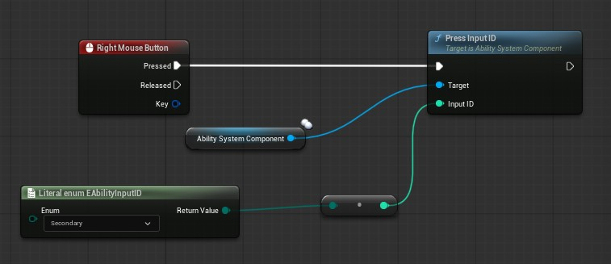
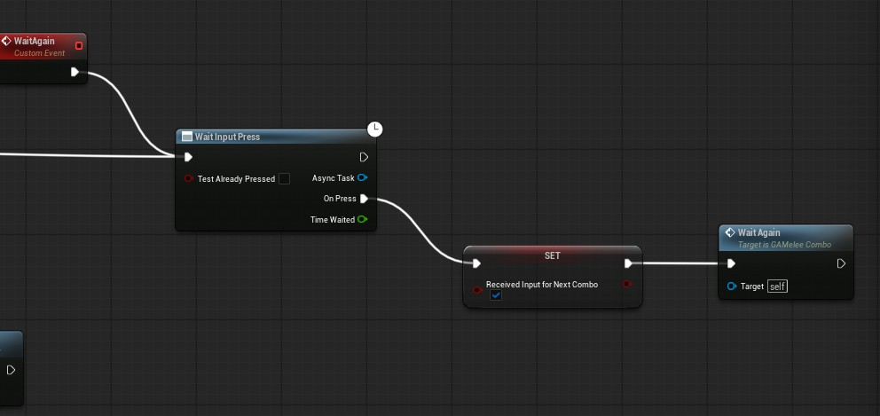
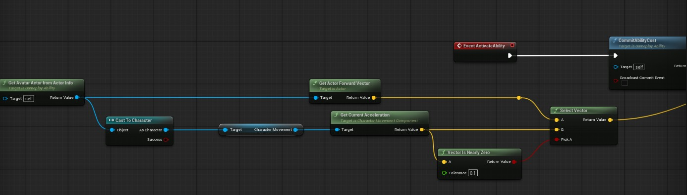

## Input IDs
In gameplay ability system you can provide an input ID to a granted ability (`int32`) and activate it using the helper node known as `PressInputID` which takes in an integer.

## Creating Enum For Each Action
One of the ways you can provide input IDs to each of your ability is by creating an enum class inside your base ability in C++ and have a public variable inside your base ability that users can set.

```cpp
UENUM(BlueprintType)
enum class EAbilityInputID : uint8
{
	None UMETA(DisplayName = "None"),
	Primary UMETA(DisplayName = "Primary"),
	Secondary UMETA(DisplayName = "Secondary"),
	Movement UMETA(DisplayName = "Movement")
};
```

And inside your `UBaseGameplayAbility` class:
```cpp
UPROPERTY(EditAnywhere, BlueprintReadWrite, Category = "Input")
EAbilityInputID AbilityInputID = EAbilityInputID::None;
```

Now go into your ability blueprints and set these enums on each of ability for example in my melee attack ability I have set it to `Primary`.

## Assigning Input IDs
In your base character class go to the function where you grant abilities to your ASC and get the default input ID and assign it instead of `-1`:
```cpp
TArray<FGameplayAbilitySpecHandle> ABaseCharacter::GrantAbilities(TArray<TSubclassOf<UGameplayAbility>> AbilitiesToGrant)
{
	if (!AbilitySystemComponent || !HasAuthority())
	{
		return TArray<FGameplayAbilitySpecHandle>();
	}

	TArray<FGameplayAbilitySpecHandle> Handles;

	for (const TSubclassOf<UGameplayAbility> Ability : AbilitiesToGrant)
	{
		int32 InputID = -1;
		if (const UBaseGameplayAbility* BaseAbilityCDO = GetDefault<UBaseGameplayAbility>(Ability))
		{
			InputID = static_cast<int32>(BaseAbilityCDO->AbilityInputID);
		}
		Handles.Add(AbilitySystemComponent->GiveAbility(FGameplayAbilitySpec(Ability, 1, InputID, this)));
	}

	return Handles;
}
```
>You can get CDO (Class Default Object) using the `GetDefault` generic.

## Handling Input Events
Inside your character blueprint all you now need to do is add input events and call the `Press Input` node like this:
<p align="center">

</p>

>Incase you need to confirm targeting data you should also call the confirm target on left mouse button input event alongside the press input node.

## Wait for Input Press Task
Inside your gameplay ability blueprints you can wait for input presses, this is very useful for things like combos where you need to listen for more than one input, here is how to do it:
<p align="center">

</p>

>Make sure to recall the task again because by default wait for input only listens for one more input.

This is really helpful because now you no longer need to wait for input events and it is much more encapsulated logic.

## Fixing Dash
We used to have ability activate using event for dash but a problem with `Press Input` node is that it only triggers the default activate ability not the one that has an event input.

We needed that event because we were passing in dash direction data from character class, this is no longer needed as we can just use the acceleration on our character movement component inside our ability which is by default replicated.
<p align="center">

</p>

>Remember `Press Input` only calls the default activate ability event not the one that takes in an event input.