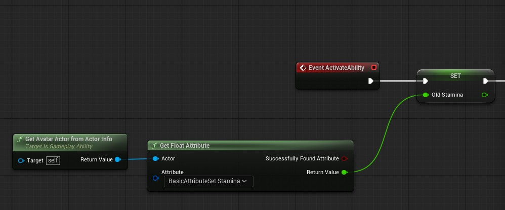
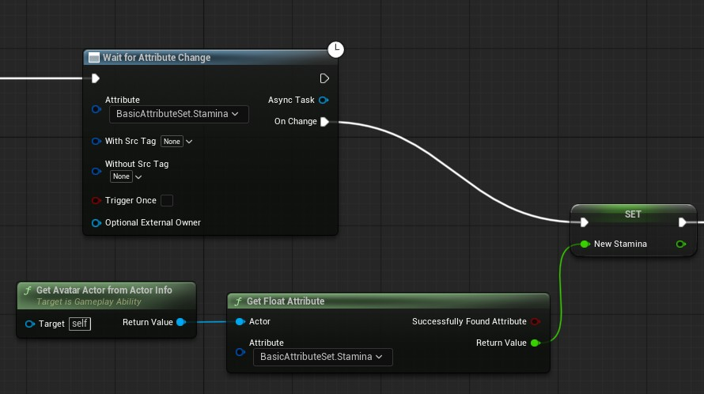
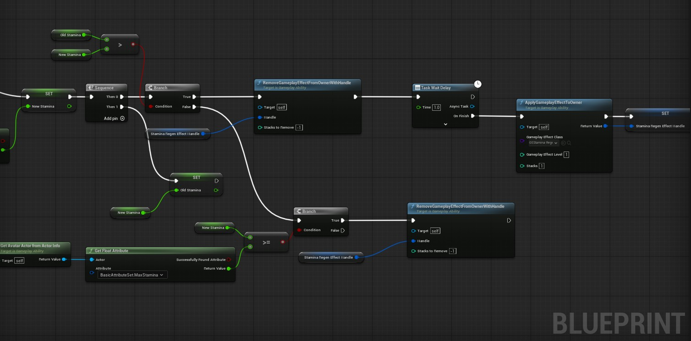
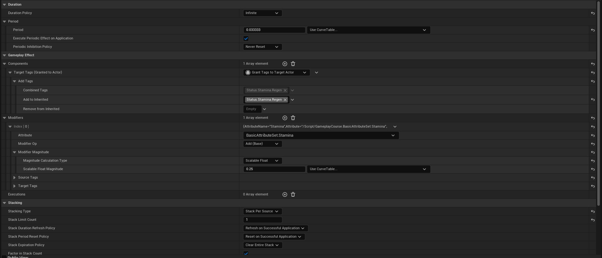
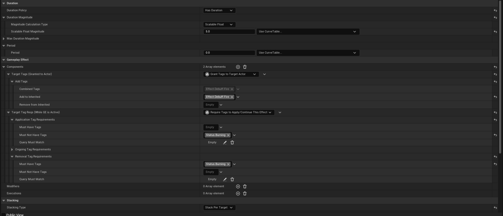
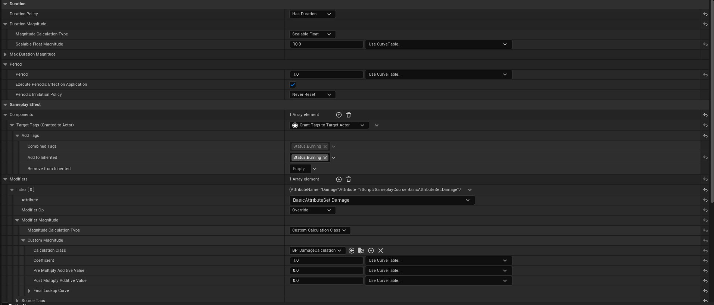
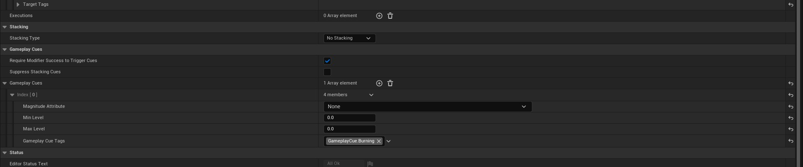
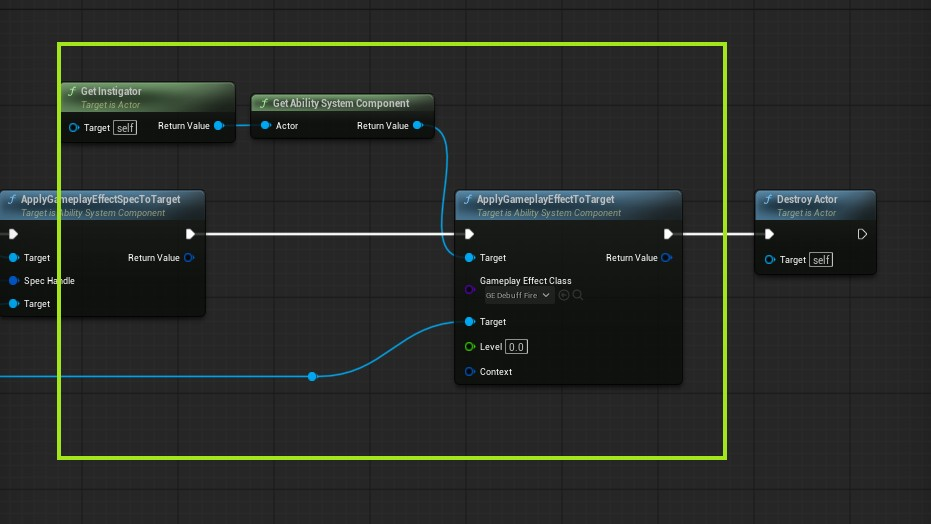
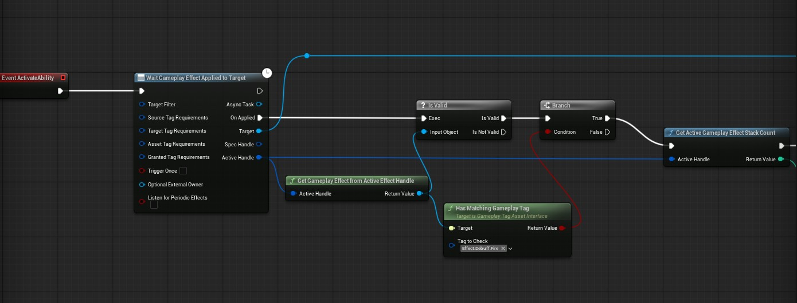
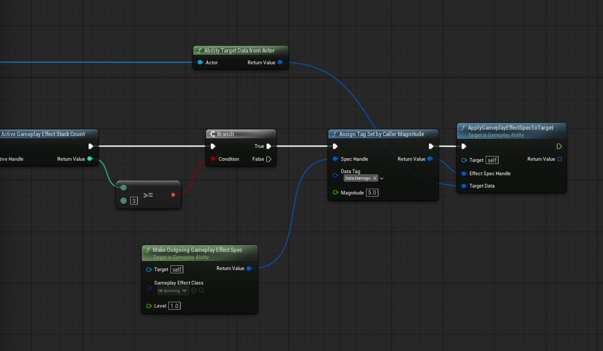

## Passive Abilities
Passive abilities are reactive abilities, they are granted on start and are active by default. Passive abilities are useful for things like regeneration, buff and debuff listeners, you can also block a passive ability using the blocked tags.

## Stamina Regeneration
We are going to be using a gameplay ability to do stamina regeneration, first create a new ability from our base ability class.

- Make sure that your ability is set to `Instance Per Actor` in the class defaults.

First, Get the old stamina through this helper node:

Wait for the attribute to change (Make sure to untick `Trigger Once`) as this is a instance per actor ability we would need to receive attribute changed even on every change not just the first one.

And lastly apply gameplay effect of stamina regeneration (which is an infinite effect we created during start) and manually remove it if stamnia value is over or equal the max stamina value.

Notice we wait for one second before applying effect, this is done through wait task node.

Just in case you are wondering how our stamina regeneration effect looks like:

## Burning Effect
Lets create a debuf which is applied when a stack of 3 burning effect is applied.

For this we will create 2 effects one would do actual damage when burning which will be our status effect and the other will act as a stack counter so it does no damage but has a duration and stack count.

## Fire Effect
This is our debuf stack counter ability looks like:

It goes on for 5 seconds, it applies tags to target of type `Effect.Debuf.Fire` and it checks if the character is already burning by tag requirement component of type `Status.Burning`.

Notice in stack section it is `Stack Per Target`.

So, on our passive ability which listens of fire effect, it will get the stack counter and apply the burning effect and that burning effect will automatically remove this debuf fire effect.

Now we create our actual burning effect:

>For cue we would use notify cue actor and set it attach to owner and spawn the fire VFX there as a component.

The important distinction here is that the burning effect actually does damage and applies the `Status.Burning` tag.

## Applying Fire Effect
The fire effect will be applied through our projectile class, when the fireball overlaps with a target it will get its ACS and apply the fire effect which will increase the stack counter by one on each hit.

>The second target input is the ACS of the target actor that was hit, the first one is the instigator, for this type of applying make sure the instigator is set on spawn.

## Burning Ability
Burning is a passive ability which will be granted to character on start and is active by default.

Here is how it looks:

>This should be instanced per actor.