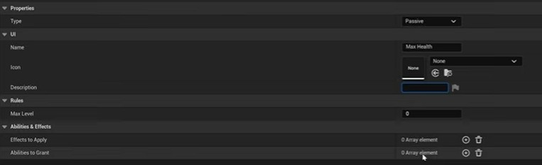
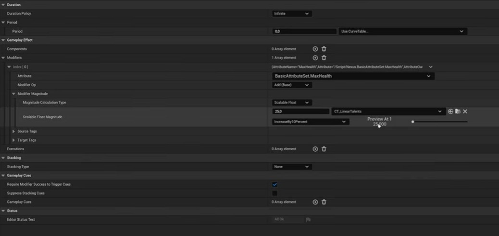
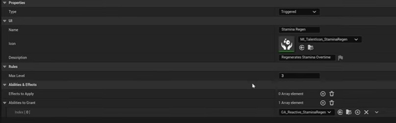
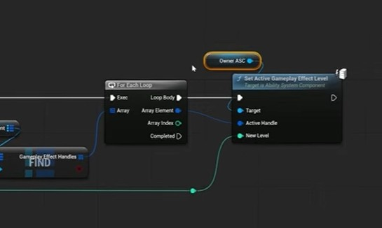

# Skill Tree
For this section I will be using a primary data asset and granting abilities based on which skill is unlocked by the player before getting started create a new `Enum` asset and add three entries to it:
- Active
- Passive
- Triggered

These entries are the types of skills we can grant, passive means it is always passive like granting a skill that increases your health by 10%, Triggered is something that is triggered when attribute changes or a tag is added this can be like a stamina regeneration ability that is triggered when stamina attribute is changed.

## Making First Passive Ability
We are going to be creating a talent that increases players max health using a curve table based on some level value, create a primary data asset with the following members:
- Type
- Name
- Icon
- Description
- Max Level
- Effects to Apply
- Abilities to Grant

And using this Primary data asset create a data asset that holds data for our passive ability.

Now that is done, we need to create a gameplay effect that actually changes our max health attribute.

Ok, now we need a curve table for this, make a linear curve table with the following settings:

## Creating a Triggered Effect
For a triggered effect we will pick our already stamina regeneration, simply create a new data asset and change the type and instead of effect grant it our old stamina regeneration ability.

>You can now remove stamina regeneration from starting abilities in your player character since we will unlock this using talent tree.

## Creating Talent Tree Component
Create an actor component for talent tree, add it to your player character and mark it replicated. It will create a Map of our Talents and their levels (since maps are not replicated in unreal engine, use a custom struct with just 2 members one integer for level and for key use the talent type). Add that struct member as an array in your component.

Create a new function called grant talents, this is where you will get the ASC of owner and grant the talents. This is very subjective on how to design this function so I will leave it blank.

## How to Level-Up Talents
Since you have granted abilities and effects now the question comes how to increase their levels, you could remove and grant them again with a bigger level but that is not a professional approach.

So, we will create a new function in our component that we called `LevelUpGrantedTalent` this takes in an input of type our talent struct (The one that contains just a level integer and data asset reference to talent).

>You need a spec handle for apply level function so make sure that you have been saving the handles of all the granted abilities and effects.

To apply the level to ability you would first need to get ability instance from spec handle and then apply level to it.