# Tips
Some tips and pit-falls you need to be aware about when working with Gameplay ability system.

## Always Prefer Tasks When Inside Ability
Use tasks with `clock` symbol on top right in abilities, these include for things like playing montage, root movement and even spawning actors.

## Authority Check
Abilities are only granted on server and are replicated to clients, similarly when using abilities make sure that you do things like spawning when inside ability only on server.

## Always Modify Attributes Through Effects
Although you can modify attributes directly but for a multiplayer project it is always recommended to modify the attributes through gameplay effects.

<p align="center">
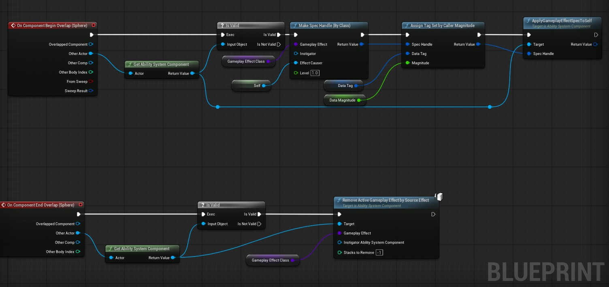
</p>

Here is an example of applying gameplay effect in a trigger actor to anyone who overlaps, you need a data tag as well in order to send custom magnitude.

This also means that in your attribute set class make sure to override functions for callbacks such as: `PreAttributeChange`, `PostAttributeChange`, `PreGameplayEffect` and `PostGameplayEffect`.

In these functions you can do a simple `if` check to see which attribute was modified and changed then you can perform clamping or even broadcast events.

### Required Tags Inside Gameplay Effect
Let's say you have an effect that assigns the invincibility tag onto your player, in order to avoid taking damage you need to go into all of your effects that are damage related and add a component called `RequiredTagsToApply/ContinueThisEffect`, and in that component add the invincibility tag in `Must Not Have` section.

This is not a good way because in case you change the tag or add new damage effect you will need to add this component to all and maintain them, another issue is this will completely block damage, may you want to reduce the damage taken as if you have a shield ability active.

In that case you should use `Custom Calculation Class`.

### Custom Calculation Class
This is where you can do custom calculations before making changes to an attribute, simple go to your gameplay effect and change the modifer from `Set By Caller` to `Custom Calculation Class`.

Once that is done, you can create a new calculation class and override a function that returns a floating point value.

The Best part is you can still get the magnitude value using the tag inside this function like this:
<p align="center">
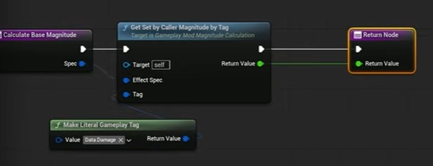
</p>

Another good thing that you can get from the spec handle is the target tags, in most cases the target is also you if you use apply gameplay effect on Owner or Self but this works on any target.

Here We are only applying half of damage if the target (We Ourselves) has shield tag:
<p align="center">
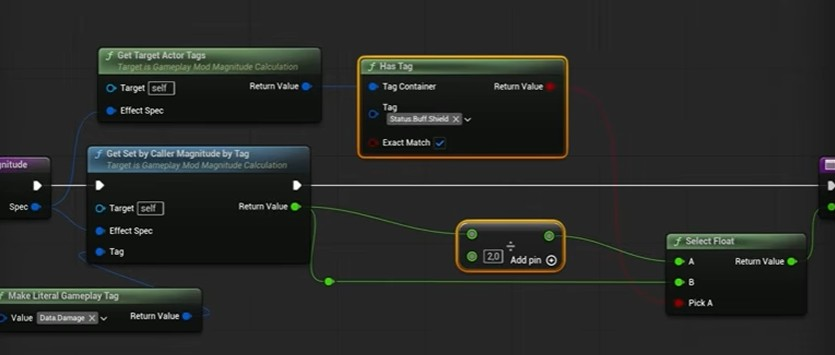
</p>

>For more flexible calculations it is recommended that you use the execution class instead.

### Use Curves To Modify the Values In Gameplay Effects


## Death Is An Ability
What happens when your attribute for health goes below `0`? We activate the death ability, death is a passive ability granted at start which applies an infinite gameplay effect to the owner.

Here is how `Death Ability` looks like:

<p align="center">
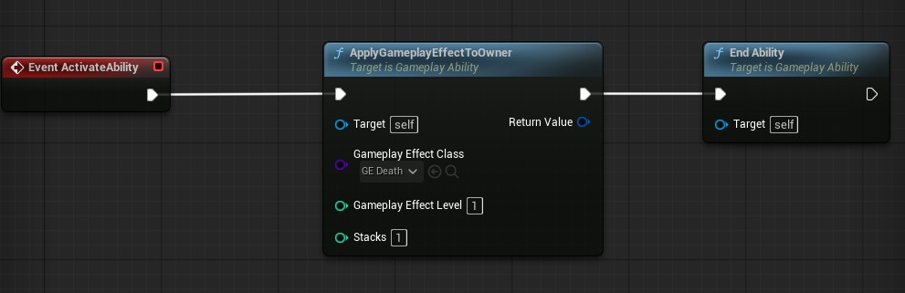
</p>

And thsi is how we activate it:

<p align="center">
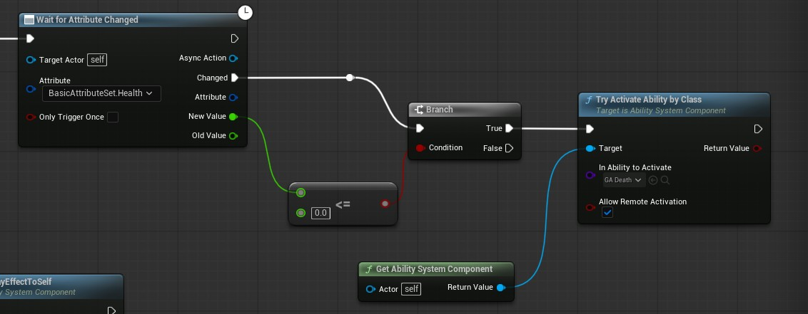
</p>

You need to listen for attribute change you can do this on begin play in your character class and when the value is below `0` try to activate the death ability.

<p align="center">
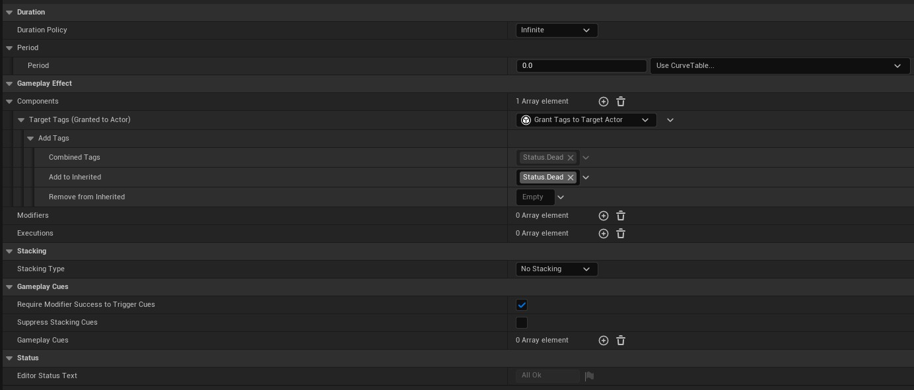
</p>

A Death effect is an infinite effect that adds `Status.Dead` tag.

## Targeting
GAS provides useful nodes for targeting data, it is called `Wait Target Data` and this can be instant or user confirmed, user confirmed requires you to call the `Target Confirm` Node.

<p align="center">
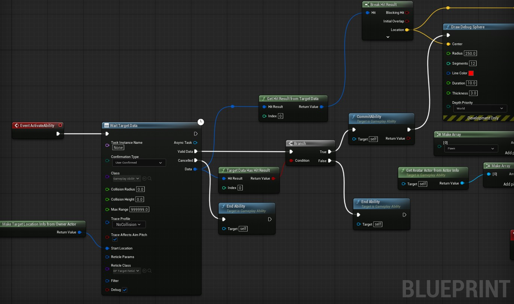
</p>

>Targeting Nodes crash on AI pawns for AI pawns use `Set Focus` on AI controller to rotate them to target and manually shoot projectile.

Since AI can also not confirm input you need to manually setup your other combo abilities in such a fashion that they support both players and NPCs.


## Cooldowns
You can assign a cooldown class inside your ability blueprint.
<p align="center">
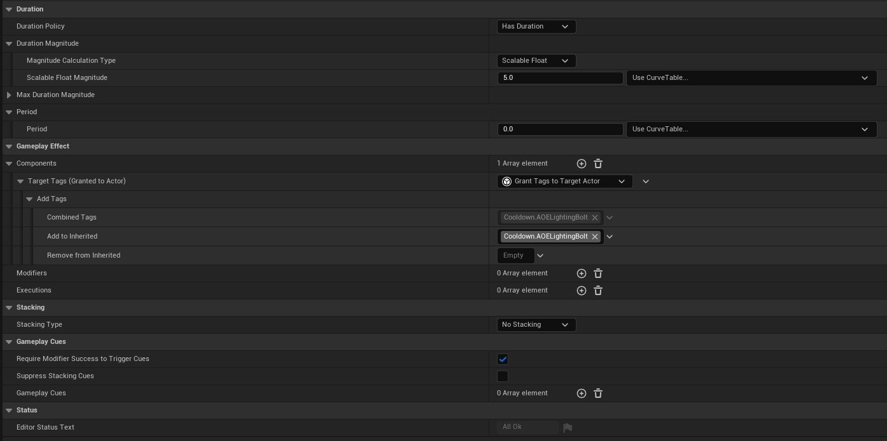
</p>

## Gameplay Cues
Here is how you can call a gameplay cue when inside an ability blueprint.
<p align="center">
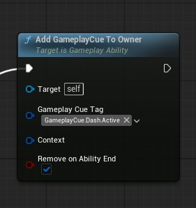
</p>

Similarly if your cue needs some information like the location where particles will be spawned you should use the parameters option.
<p align="center">
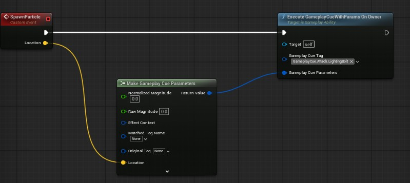
</p>

Gameplay Effects can also have Cues, which are automatically destroyed once the effect expires, this is useful for abilities like Shield or buffs which just apply a gameplay effect to owner and in that effect you can assign a cue.

>In case you want to spawn an actor as cue make sure that you sub-class `GameplayCueActor` and in its class defaults there is a tick option called `Attach To Owner`.


## Combos
Some abilities in your game would be massive like combos that play different animations and require input to progress.
<p align="center">
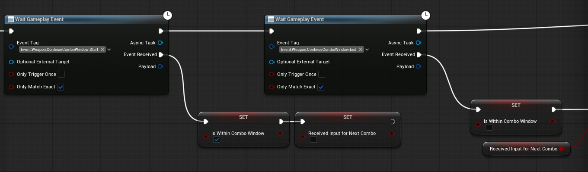
</p>

You should create an anim notify and send tags through it and wait for those gameplay events inside your ability.

Same goes for input:
<p align="center">
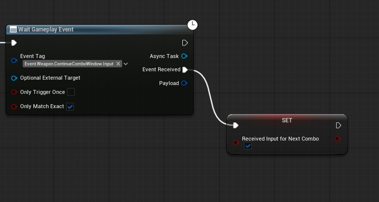
</p>

And inside your character class on input you can send another gameplay event that tells your ability that input has been pressed.
<p align="center">
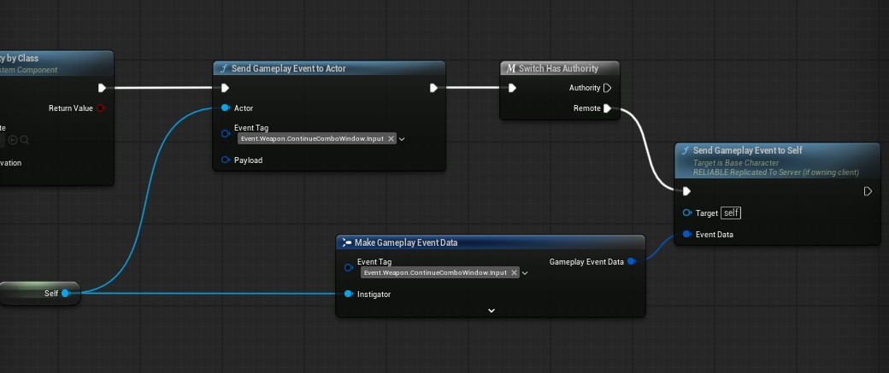
</p>

## Check If Ability User is Player Controller or AI
In your base ability class you can create a very handy function that allows you to check if the user is AI Controller or Player, this is very helpful in abilities that don't work when the user is AI or requires input.

```cpp
Code Here
```