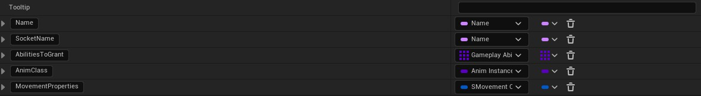
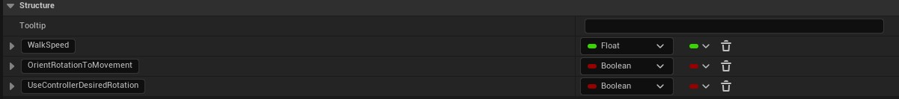
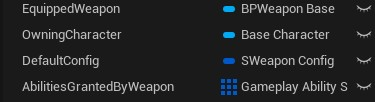
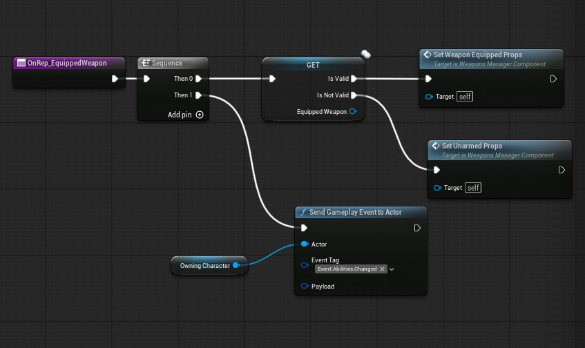
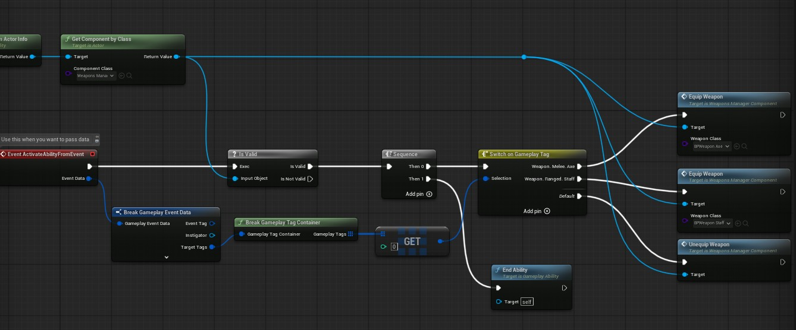
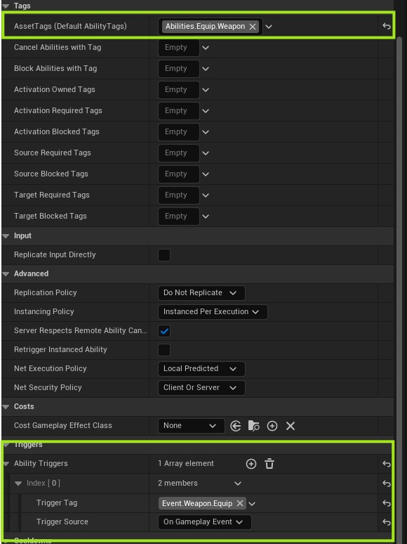
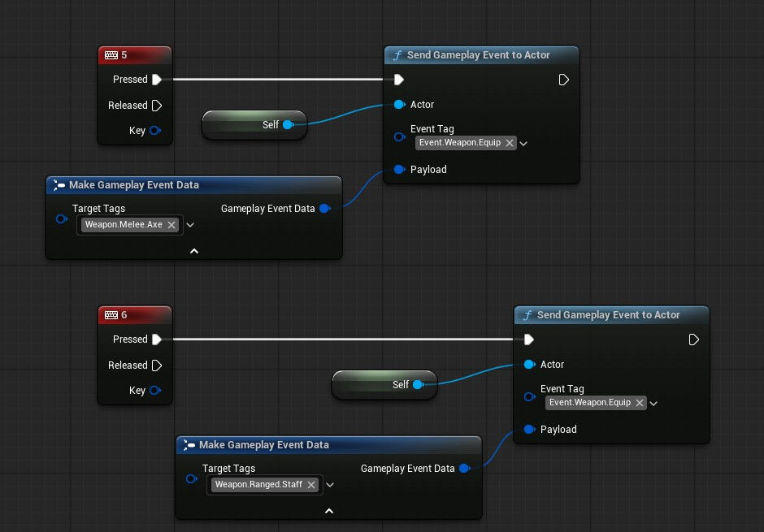

# Weapons
Let's start by creating a weapon actor in blueprints, that will contain a mesh component, two scene components that are used as locations for trace start and end.

We will also have the following variables which we can change in the derived child blueprints.
- Trace Radius of type float.
- Timer handle.
- Effect spec handle.
- Hit actors set.
- weapon config.

Let us start by create a structure which defines our weapon config, create a new struct asset and fill up the details like this:

Notice that we have another custom variable called movement properties? that is also a struct that only contains three elements.

>Make sure to tick the 'Replicates' checkbox in your weapon base class blueprint.

## Weapon Manager Component
We will create a weapons manager component that will live on our player and also is replicated. In that component we will handle the weapon equiping logic.

These are the variables that live in our weapon manager component:

On begin play just get owner, cast to character class and store the reference to owning character.

> Equip weapon variable should be set to `RepNotify` as we need to call the function on client when it is changed.

Create two custom events:
- Equip Weapon.
- Unequip Weapon.

Equip weapon takes in a class that is the type of our weapon base, it will also only run on server as we only want to spawn the weapon on server.

once the weapon is spawned you set your `Equipped Weapon` variable and since it was `RepNotify` it will call a function on clients where you can set the movement and weapon properties on each client as well.

We also grant abilities on server using our custom function which we created in C++ and we send the gameplay event of `Event.Abilitis.Changed` again so it goes in both server and client.

## Granting Weapon Equip Ability
Now to actually swap this weapon and call equip functions we need to create an ability called `GAWeaponEquip` this will be granted on start to our players.

And here is the details panel of weapon equip ability, notice we will be using ability triggers and calling it using a tag, the tag which will be passed in our data will define which weapon we equip.

## Equip Input
Now lets go back to our player blueprint and hook this up.

We will discuss the tracing, hit and damage of weapon in next article.